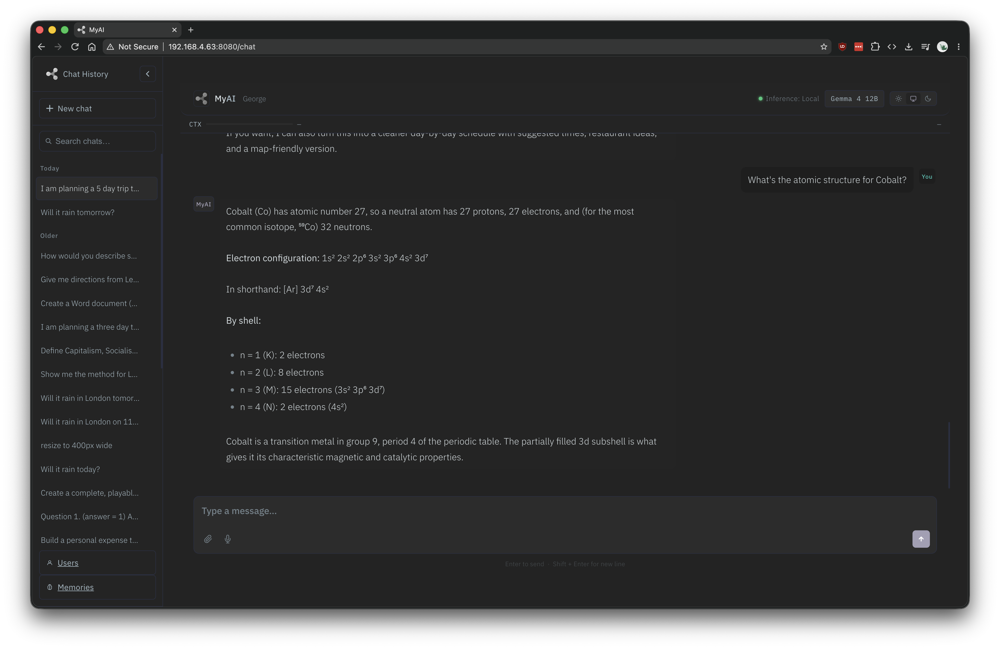

<h1 align="center">MyAI</h1>

<p align="center"><strong>Private. Local. Yours.</strong></p>

<p align="center">
  A friendly AI assistant for your family that runs entirely on your own Mac.
  <br>Your chats, files and memories stay at home.
</p>

<p align="center">
  
  
  
</p>

<p align="center">
  
</p>

---

## What is MyAI?

MyAI is a chat assistant, like the ones you've used online, except that the AI
runs on your own Mac. Nobody else sees what you type. Everyone in the family
gets their own account with a PIN, and MyAI adjusts its tone for young children,
teenagers, adults and seniors.

You can use it from the Mac itself, or from any phone, tablet or computer on
your home Wi-Fi.

> **MyAI runs on Macs with Apple Silicon (M1 or later) for now.** Windows and
> Linux versions are on the way.

## What it can do

- **Chat** about anything: questions, explanations, writing, homework help, ideas.
- **Weather**, with forecasts for your home town or anywhere else.
- **Web search and news**, for things that happened after the AI was trained.
- **Maths and conversions**, worked out exactly rather than guessed.
- **Currency, time zones, driving directions and Wikipedia** look-ups.
- **Documents**: ask for a Word document, a spreadsheet or a text file, and download it.
- **Read your files**: attach a PDF, Word document, spreadsheet or text file and ask about it.
- **Edit photos**: resize, crop, rotate, convert or turn them black and white.
- **Voice**: talk instead of typing (the speech is turned into text on your Mac).
- **Memories**: tell it something once ("remember I'm vegetarian") and it remembers.

## What you need

- A Mac with **Apple Silicon** (M1, M2, M3, M4 or later)
- **16 GB of memory** or more (see [Choosing a model](#choosing-a-model))
- **Python 3.13 or later**. If you don't have it, setup tells you where to get it.
- **Apple's Command Line Tools**. Setup checks, and installs them for you if needed.
- An **AI model file** (a `.gguf` file, usually 8–35 GB). See [Choosing a model](#choosing-a-model).
- About **30 minutes**, most of it waiting while MyAI's AI engine is built for your Mac

## Installing MyAI

Open **Terminal** (in Applications → Utilities) and run:

```bash
git clone https://github.com/TheTechy/MyAI.git
cd MyAI
./install.sh
```

Setup walks you through six short steps. Use the arrow keys and Enter:

1. **Check this Mac.** Memory, Apple Silicon and the developer tools.
2. **Choose a model.** Pick one from the `models` folder, or point to one stored elsewhere.
3. **Optional extras.** Weather (needs a free
   [OpenWeatherMap](https://openweathermap.org/api) key), where web searches
   should focus, and voice input.
4. **Your account.** Your name and a 4-digit PIN.
5. **Review.** Check your choices. Nothing is changed until you say so.
6. **Install.** Builds the AI engine and installs everything else. Time for a cuppa.

Everything is installed inside the MyAI folder. Nothing needs your Mac's admin
password, and nothing is installed system-wide.

**Changing your settings later:** run `./install.sh` again. Your current
answers are the defaults, so press Enter through anything you want to keep.

## Starting MyAI

In the MyAI folder, run:

```bash
./start.sh
```

It shows you two addresses:

```
  Starting MyAI…
    On this Mac:           http://localhost:8080
    On your home network:  http://Your-Mac.local:8080
```

Open the first on the Mac itself, or the second on a phone, tablet or another
computer on the same Wi-Fi. Sign in with your name and PIN.

Loading the AI model takes a minute or so. To stop MyAI, press **Ctrl-C** in
Terminal.

Your browser will say the page is **"Not Secure"**. That's normal for a website
on your own home network. It just means the page isn't using `https`.

> **Tip:** if MyAI lives on a Mac that's always on (a Mac mini, say), turn on
> *Prevent automatic sleeping* in System Settings → Energy so it's always there
> when someone needs it.

## Choosing a model

MyAI works with AI models in the **GGUF** format, which you can download for free
from [Hugging Face](https://huggingface.co) (the
[Unsloth](https://huggingface.co/unsloth) versions are a good place to start).
Put the `.gguf` file in MyAI's `models` folder, and setup will find it.

The right size depends on your Mac's memory. Setup labels each model for you as
**fits**, **tight** or **too big**. As a rough guide:

| Your Mac's memory | Model file size that fits comfortably | For example | Conversation memory |
|---|---|---|---|
| 16–18 GB | up to about 8–9 GB | Gemma 4 12B (Q5) | 16,384 tokens |
| 24 GB | up to about 12 GB | Gemma 4 12B (Q8) | 16,384 tokens |
| 32 GB | up to about 17 GB | a 27B model (Q4) | 32,768 tokens |
| 48 GB | up to about 28 GB | a 27–31B model (Q5) | 32,768 tokens |
| 64 GB or more | up to about 38 GB | a 31B model (Q8) | 32,768 tokens |

**What the letters mean:** the "B" number is the model's size (bigger is
smarter, but slower and hungrier). "Q4", "Q5" and "Q8" describe how much it has
been compressed. **Q5 is a good default.** It's almost as good as Q8 and much
smaller.

**Conversation memory** (the "context") is how much of a chat MyAI can keep in
mind at once. More lets you have longer chats and work with bigger documents,
but uses more of your Mac's memory.

## Things to try

| Ask MyAI… | What happens |
|---|---|
| "Will it rain tomorrow?" | A forecast for your home town |
| "What's the weather like in Paris this weekend?" | A forecast anywhere |
| "What is 12^12?" or "What's 15% of 240?" | Exact maths |
| "How much is 50 dollars in pounds?" | Today's exchange rate |
| "What time is it in Tokyo?" | Time zones |
| "Give me driving directions from Leeds to York" | A route with distance and time |
| "What's in the news today?" | Today's headlines |
| "Who won the football last night?" | A web search |
| "Look up the Eiffel Tower on Wikipedia" | A Wikipedia summary |
| "Create a Word document about the Battle of Britain" | A `.docx` file to download |
| "Make a spreadsheet to track my monthly bills" | An `.xlsx` file to download |
| *(attach a PDF)* "Summarise this for me" | Reads your file |
| *(attach a photo)* "Resize this to 400 pixels wide" | An edited photo |
| "Remember that I'm allergic to peanuts" | Saved to your memories |
| "Explain photosynthesis like I'm ten" | Just a good answer, no tools needed |

## Family accounts

- **Adding people:** sign in and open **Users** (bottom left). Give each person
  a name, a PIN and an age group: *Child (6–10)*, *Teen (11–16)*, *Adult* or *Senior*.
  MyAI adjusts how it talks to suit each one.
- **Memories:** each person's memories are their own. Open **Memories** to see
  or delete what MyAI remembers about you.
- **Chats** are private to each account.

## Your privacy

**Stays on your Mac:** the AI itself, everything you type, every answer, your
files, your memories and your voice recordings. There is no tracking and no
analytics.

**Goes online, only when needed:**

| When you… | MyAI contacts… | and sends… |
|---|---|---|
| ask about the weather | OpenWeatherMap | the place name |
| ask it to search the web | DuckDuckGo | the search words |
| ask for the news | public news feeds (BBC, Guardian, Sky and others) | nothing (it just reads the headlines) |
| ask for directions | OpenStreetMap | the two place names |
| ask about currencies | Frankfurter (European Central Bank rates) | the currencies |
| ask it to look something up | Wikipedia | the topic |

Your conversation itself is never sent. The chat page also loads its fonts and
some display tools from public websites (Google Fonts and code libraries), and
with voice turned on, MyAI downloads its speech model once, the first time it starts.

## Good to know

MyAI is a home project. Please be aware of these limitations:

- **PINs keep family members apart, but they aren't strong security.** PINs are
  stored unencrypted, and anyone signed in can manage every account on the
  Users page, including changing other people's PINs.
- **Keep MyAI on your home network.** Don't make it reachable from the internet.
- **AI can be confidently wrong.** Check anything important, especially health,
  money or legal questions.
- **Mac only for now.** Windows and Linux versions are on the way.

## If something goes wrong

**The AI engine didn't build.** Setup shows the end of the error, and the full
details are in `install.log` in the MyAI folder. Run `./install.sh` again: your
answers are saved, so it picks up where it left off.

**Setup says the model is "too big".** It won't fit in your Mac's memory. Choose
a smaller model, or a more compressed version (Q4 instead of Q5, for example).

**"Address already in use" when starting.** Something else is using the port.
Run `./install.sh`, choose *Change the port* on the review screen, and try 8081.

**Phones and tablets can't connect.** Check they're on the same Wi-Fi as the
Mac. If your Mac asked whether to allow incoming connections, choose *Allow*. If
you said no, change it in System Settings → Network → Firewall.

**Forgotten PIN.** Anyone else signed in can set a new one on the **Users** page.

## Updating MyAI

In the MyAI folder:

```bash
git pull
./install.sh
```

Your settings, accounts and chats are kept. The AI engine is only rebuilt when
a new version needs it.

## For developers

How MyAI works, the tests and the settings reference are in
[docs/DEVELOPING.md](docs/DEVELOPING.md).

## Licence

[MIT](LICENSE) © 2026 George Duff

## Thanks

Built on [llama.cpp](https://github.com/ggml-org/llama.cpp) via
[llama-cpp-python](https://github.com/abetlen/llama-cpp-python), with models from
the open-source community (Google Gemma, Alibaba Qwen, Meta Llama) and the GGUF
versions from [Unsloth](https://huggingface.co/unsloth). Maps and directions ©
[OpenStreetMap](https://www.openstreetmap.org/copyright) contributors.
