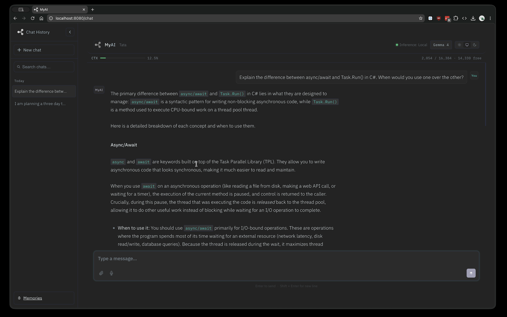

<p align="center">
  
</p>

<h1 align="center">MyAI</h1>

<p align="center"><strong>Private. Local. Yours.</strong></p>

<p align="center">
  A privacy-first, local LLM assistant for families and small teams — it runs
  entirely on your own hardware, answers naturally, and reaches for tools
  (weather, maths, directions, search, files and more) only when they help.
  No cloud, no accounts, no data leaving your machine.
</p>

<p align="center">
  
  
  
</p>

---

## What is MyAI?

MyAI is a self-hosted AI assistant you run on your own Mac. It's built for
households and small businesses who want the usefulness of a modern chat
assistant **without** sending their conversations, documents, or questions to a
third party. Everything — the model, your chats, your memories, your files —
stays on your machine.

Under the hood it runs open GGUF models (Gemma, Qwen, Llama, …) locally via
`llama.cpp`, and wraps them in a small, carefully-engineered core that decides
when to answer directly and when to use a tool.

> **This release targets macOS on Apple Silicon.** Windows and Linux are on the
> roadmap — the architecture is deliberately OS-agnostic, but only the Mac path
> is built and tested today.

## Screenshots

<!-- TODO: replace with a real chat screenshot, e.g. docs/screenshot-chat.png -->
<p align="center"><em>A chat screenshot goes here.</em></p>

## Features

- **Model-agnostic core** — swap between local models (Gemma 4, Qwen 3.x, Llama,
  …) by changing one line in your config. Nothing is hard-wired to a single model.
- **Smart routing** — a single-pass "reason-then-emit" router decides whether to
  answer from the model's own knowledge or call a tool, and picks the right one.
- **Built-in skills** — weather, calculator, currency, date/time, web search,
  news, driving directions, Wikipedia lookups, image editing, and long-term memory.
- **File generation** — ask for a `.txt`, `.md`, `.docx`, `.xlsx`, code file, and
  more; MyAI produces a real downloadable file.
- **Image editing** — upload a photo and ask to resize, crop, rotate, convert, or
  greyscale it.
- **Voice input** — speak your question; transcription runs locally via Whisper
  (optional).
- **Long-term memory** — tell it something once ("remember I'm allergic to
  peanuts") and it recalls it naturally in future chats.
- **Age-appropriate personalities** — per-user tone for young children, teens,
  adults, and seniors.
- **Private by design** — no telemetry, no external calls except the tools *you*
  enable (e.g. weather/search), all data in a local SQLite database.

## Architecture (brief)

MyAI v2 is built around an OpenAI-shaped message format used **in-process** — no
API keys, no HTTP to any provider. The request pipeline is:

```
user turn → router (reason-then-emit) → dispatch to a skill (or answer directly)
          → stream the answer → Server-Sent Events → browser
```

Key design decisions are recorded as ADRs in [`docs/`](docs/):

- **ADR-0001** — the pluggable inference-backend seam (in-process default).
- **ADR-0002** — retiring the old text-tag routing in favour of structured
  selection.

The core lives in [`core/inference/`](core/inference/) (backend, router, dispatch,
pipeline, streaming), skills in [`myai_skills/`](myai_skills/), and the web app in
`app.py` + `templates/` + `static/`.

## Supported models & memory guidance

MyAI runs any `llama.cpp`-compatible **GGUF** model. Because it's model-agnostic,
you choose based on your Mac's memory. From real testing on a 64 GB M4 Pro:

| Model | Quant | Approx. RAM | Notes |
|-------|-------|-------------|-------|
| Gemma 4 12B | Q8 | ~13 GB | **Recommended default** — fast, accurate, huge headroom |
| Gemma 4 31B | Q5 (UD) | ~22 GB | Best quality/RAM balance; comfortable on 32 GB+ |
| Gemma 4 31B | Q8 | ~35 GB | Top quality; tight on 64 GB — keep `CTX_SIZE` modest |
| Qwen 3.x 27B | Q5/Q8 | ~20–35 GB | Strong, but a "thinking" model — slower per reply |

Rules of thumb:

- **Quantisation:** Q5 is nearly indistinguishable from Q8 in practice and saves a
  lot of memory — a great default. Q4 is usable but noticeably weaker on precise
  tasks. Q6/Q8 for maximum fidelity if you have the RAM.
- **Context size:** bigger `CTX_SIZE` uses more memory. A large model **and** a
  large context can exceed your RAM — if the app crashes on load, lower `CTX_SIZE`
  or pick a smaller/more-quantised model.
- **Where to get models:** Hugging Face (e.g. the Unsloth GGUF releases). Place the
  `.gguf` file in `models/` and point `MODEL` at it.

## Requirements

**Hardware**
- Apple Silicon Mac (M1 or later). Unified memory is what matters.
- 16 GB minimum (small models), 32 GB recommended, 64 GB for the largest models.
- Disk space for models (a single GGUF is ~10–35 GB).

**Software**
- macOS (Apple Silicon)
- Python **3.14+**
- The Python dependencies in `requirements.txt`

## Installation (scripted — recommended)

The quickest way on macOS (Apple Silicon). Clone, then run the installer — it
finds a suitable Python, creates a local `.venv`, installs `llama-cpp-python`
from the prebuilt **Metal** wheel (no Xcode/compile), installs the rest, and
walks you through config (model path, optional weather/search/voice, first user):

```bash
git clone https://github.com/TheTechy/MyAI.git
cd MyAI
./install.sh
```

Nothing needs `sudo`; everything lives in `./.venv`. When it finishes, start MyAI
with `.venv/bin/python app.py` and open **http://localhost:8080**.

Knobs are overridable, e.g. to pin a different engine version:
`LLAMA_VERSION=0.3.33 ./install.sh`. If no Python 3.14+ is found, the installer
points you at the official download and exits so you can install it and re-run.

## Installation (manual)

> Prefer the scripted installer above. These steps are the same thing by hand.

**1. Clone the repo**
```bash
git clone https://github.com/TheTechy/MyAI.git
cd MyAI
```

**2. Create a virtual environment (Python 3.14+)**
```bash
python3 -m venv .venv
source .venv/bin/activate
```

**3. Install dependencies**

Install `llama-cpp-python` from the prebuilt **Metal** wheel index first (no
source compile, no Xcode needed), then the rest:
```bash
pip install --extra-index-url https://abetlen.github.io/llama-cpp-python/whl/metal llama-cpp-python==0.3.35
pip install -r requirements.txt
```
> The Metal wheel index is load-bearing on Apple Silicon — plain PyPI has no
> prebuilt wheel for Python 3.14, so without it pip falls back to compiling from
> source (slow, needs the Xcode command-line tools). If `requirements.txt` pins a
> different `llama-cpp-python`, the first command wins as long as it runs first.

**4. Download a model**

Download a GGUF (see the table above) and place it in `models/`, e.g.
`models/gemma-4-12b-it-UD-Q8_K_XL.gguf`.

**5. Configure**
```bash
cp .env.example .env
```
Edit `.env` — at minimum set `MODEL` (path to your `.gguf`) and a `SECRET_KEY`.
Generate a secret key with:
```bash
python3 -c "import secrets; print(secrets.token_hex(32))"
```

**6. Run**
```bash
python3 app.py
```
Then open **http://localhost:8080** in your browser. On first launch MyAI creates a
setup user; sign in and you're away.

## Configuration reference (`.env`)

| Variable | Required | Description |
|----------|----------|-------------|
| `MODEL` | ✅ | Path to your `.gguf` model file |
| `SECRET_KEY` | ✅ | Flask session secret (generate a random one) |
| `MYAIDB` | – | Path to the SQLite database (default `./instance/myai.db`) |
| `CTX_SIZE` | – | Context window in tokens (`0` = the model's trained max) |
| `PORT` | – | Web server port (default `8080`) |
| `WARMUP` | – | `1` to warm the model at startup (faster first reply) |
| `OWM_API_KEY` | – | OpenWeatherMap key — enables the weather skill |
| `OWM_UNITS` | – | `metric` \| `imperial` \| `standard` |
| `OWM_HOME_CITY` | – | Default location for "will it rain today?" |
| `SEARCH_REGION` | – | Web-search region, e.g. `uk-en`, `wt-wt` |
| `WHISPER_MODEL` | – | Whisper model for voice input, e.g. `base.en` (blank = off) |
| `WHISPER_DEVICE` | – | `cpu` or `cuda` |
| `WHISPER_COMPUTE` | – | Compute precision, e.g. `int8` |

Skills that need a key or network (weather, search, news, directions, currency,
Wikipedia) are optional — leave the relevant settings blank to disable them.

## Skills

| Skill | Example |
|-------|---------|
| Calculator | "what's 15% of 240", "convert 100 miles to km" |
| Currency | "how much is 50 USD in GBP?" |
| Weather | "what's the weather in Rochdale?" |
| Date & time | "what time is it in Tokyo?" |
| Web search | "who won the match last night?" |
| News | "what's in the news today?" |
| Directions | "driving directions from Manchester to Leeds" |
| Wikipedia | "look up the Eiffel Tower on Wikipedia" |
| Image editing | (upload) "resize this to 400px wide" |
| Memory | "remember I drink tea", "what do you remember about me?" |

Anything the model already knows (timeless facts, explanations, writing, coding) is
answered directly — no tool needed.

## Testing

MyAI ships with a smoke-test suite that runs without a model or database (it uses
fakes), plus a few that exercise a real model:

```bash
# fast, no model needed:
PYTHONPATH=. python3 test_suite/smoke_router.py
PYTHONPATH=. python3 test_suite/smoke_pipeline.py
# …and the other smoke_*.py

# with a real model loaded (set MODEL in .env first):
python3 scripts/router_eval.py --model ./models/<your-model>.gguf
```

## Project structure

```
app.py                 # Flask web app + SSE endpoint
core/
  db.py, prompts.py, file_generation.py, file_ingestion.py
  inference/           # the v2 engine: backend, router, dispatch, pipeline, streaming
myai_skills/           # the built-in skills + registry
data/                  # age-band personalities
static/ templates/     # web UI
test_suite/            # smoke + unit tests
scripts/               # evaluation & maintenance tooling
docs/                  # architecture decision records (ADRs)
```

## Roadmap

- **One-click installer** — a native macOS app that sets up Python, dependencies,
  and models with a friendly UI (RAM-aware model recommendations).
- **Windows & Linux** — the architecture is OS-agnostic; these are next after Mac.
- **User-created skills** — a guided, safe way for users to build their own simple
  tools (e.g. a bespoke calculator), voice-friendly for hands-busy moments.

## Platform support

| Platform | Status |
|----------|--------|
| macOS (Apple Silicon) | ✅ Supported |
| Windows | 🔜 Planned |
| Linux | 🔜 Planned |

## License

[MIT](LICENSE) © TheTechy

## Acknowledgements

Built on [`llama.cpp`](https://github.com/ggml-org/llama.cpp) via
[`llama-cpp-python`](https://github.com/abetlen/llama-cpp-python), with model
weights from the open-source community (Google Gemma, Alibaba Qwen, Meta Llama,
and the excellent GGUF quantisations from [Unsloth](https://huggingface.co/unsloth)).
